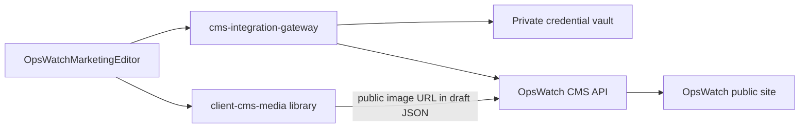

# Complete Visual CMS V1 — OpsWatch (scoped plan)

| Field | Value |
| --- | --- |
| Status | APPROVED — local development |
| Production | HOLD |
| Date | 2026-10-13 |

## Inspection summary

### Reusable today

| Asset | Path | Role |
| --- | --- | --- |
| Pro visual builder | `admin/src/components/cms-builder/ProVisualBuilder.tsx` | Viewport preview, rails, click-select, media upload patterns |
| Visual editor export | `admin/src/components/VisualCmsEditor.tsx` | Alias of ProVisualBuilder for `okang_native` |
| Section preview | `admin/src/components/CmsSectionPreview.tsx` | Click-to-edit section chrome |
| Media library | `admin/src/components/CmsMediaLibrary.tsx` | Upload, alt text, signed URLs |
| OpsWatch editor | `admin/src/components/OpsWatchMarketingEditor.tsx` | Gateway put/preview/publish/rollback (hero-only today) |
| Workspace routing | `admin/src/pages/ClientCmsWorkspacePage.tsx` | Routes `opswatch_marketing` → OpsWatch editor |
| Gateway | `supabase/functions/cms-integration-gateway` | Vault credential; API key never in browser |
| Grants | `can_edit` / `can_publish` on workspace | Editors do not auto-publish |

### OpsWatch content contract (do not replace)

Frozen modules in OpsWatch `apps/web/src/content/marketing/contract.ts`:

- `opswatch.site.chrome` — nav, footer, blurbs
- `opswatch.page.*` — home, platform, features, ai-intelligence, integrations, solutions, pricing, security, about, contact

Types: `MarketingPageContent`, `MarketingSection`, `MarketingCard`, `MarketingSiteChrome`.

Pricing amounts / Stripe / entitlements stay outside CMS (`CMS_FORBIDDEN_BILLING_KEYS`).

Public site fail-open: `resolve.ts` falls back to seed when published fetch fails.

### Gaps vs Complete Visual CMS

| Capability | Today | V1 target |
| --- | --- | --- |
| Click-to-edit text / buttons | Hero fields only | Hero, sections, cards, CTAs, SEO |
| Homepage sections | Not editable | Edit + reorder; required home slots locked |
| Feature cards / icons | Not editable | Full card edit |
| Images | Illustrations are React components | Optional `image` on hero/section; media library picker |
| Navigation / footer | Chrome module blocked | Full chrome editor |
| SEO | Not editable | metaTitle / metaDescription |
| Responsive preview | None | Desktop / tablet / mobile frame (reuse builder viewport UX) |
| Draft / preview / publish / rollback | Working | Preserve + revision display |
| Media durable on public site | N/A | Long-lived signed URL stored in content (no new DB) |

## Architecture decision

**Do not** map OpsWatch modules into `CmsBuilderDoc` / ProVisualBuilder tree. That would break the OpsWatch marketing renderer and risk layout damage.

**Do** extend `OpsWatchMarketingEditor` into a marketing visual workspace that:

1. Reuses ProVisualBuilder UX patterns (viewport widths, toolbar, inspector rails, media pick flow).
2. Edits marketing JSON via the existing gateway.
3. Keeps grant checks (`canEdit` / `canPublish`).

## Implementation stages

### Stage 1 — Structured multi-page editor

- Module switcher for all catalogue modules including chrome.
- Page: SEO, hero (eyebrow/title/subtitle/CTAs/pills), sections (text, cards, CTAs), add/remove/reorder with home required IDs locked.
- Chrome: productBlurb, footerNote, nav, footerCompany, footerGetStarted.
- Preserve save draft / preview / publish / rollback.

### Stage 2 — Visual canvas + responsive preview

- Live preview iframe / framed canvas with desktop/tablet/mobile widths.
- Click section in list focuses inspector (click-to-edit model for marketing JSON).
- Soft OpsWatch colour tokens in editor chrome (navy / electric blue).

### Stage 3 — Media

- Embed media picker (reuse upload + signed URL helpers).
- Additive optional `image?: { url, alt, storagePath? }` on hero and sections in OpsWatch types + seed-safe merge.
- Store long-expiry signed URL so published pages keep working without exposing credentials.
- Skip if no `client_id` on product instance: show URL field only.

### Stage 4 — Verify + commit

- Local Owner journey (edit section + SEO + chrome + publish + rollback).
- Confirm seed fail-open still works.
- Local commits only; no push / no production DB.

## Out of scope (V1)

- Replacing homepage React illustration components with freeform layout builder.
- Changing OpsWatch subscription / billing UI via CMS.
- Production / Vercel / hosted Supabase apply.
- Destructive migrations.
